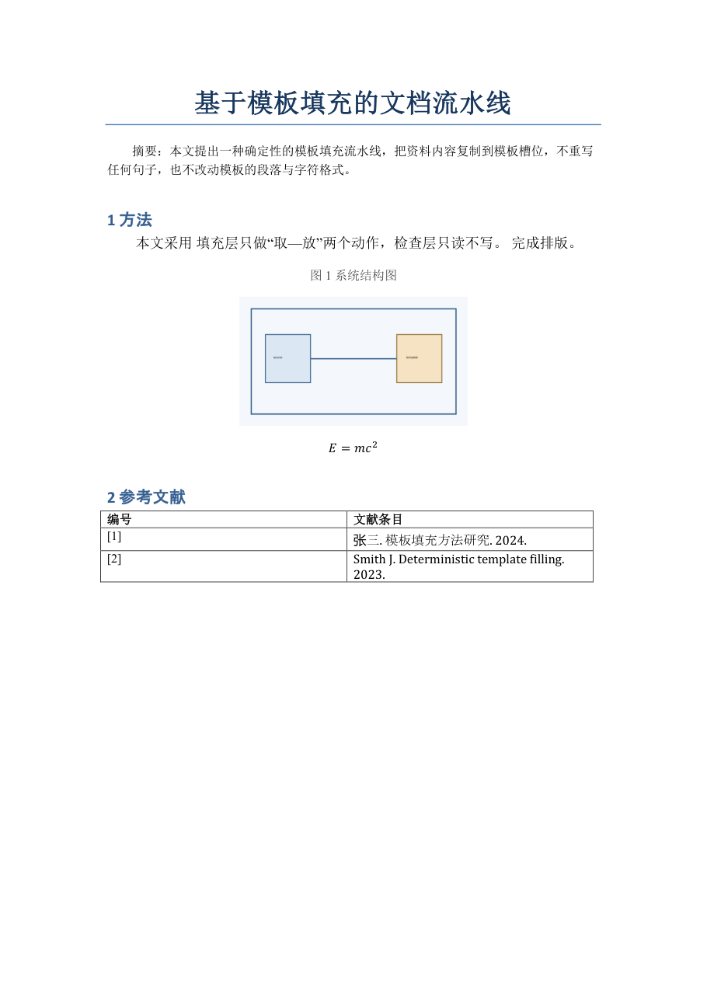

# DSH-word：确定性模板填充 + 整篇换版式 + 质量门禁

把资料内容**复制**进 Word 模板，不重写任何一句话；再把整篇稿件按另一套模板**重排版式**；
最后用一套可配置的确定性规则检查结果。填充与检查是两个互不调用的 Worker：填充只做"取—放"，
检查只读不写，修正动作统一回到 Router（本仓库提供的是 Worker 侧能力，Router 接线见文末）。

**安装与上手：见 [INSTALL.md](INSTALL.md)**（`pip install` / 一键脚本 / DSH 插件三种方式）。



## 两种任务，别用错命令

| 任务 | 命令 | 说明 |
|---|---|---|
| 内容填进模板**已有段落**（结构不变） | `dsh-word fill` / `map-apply` | 模板的章节顺序、槽位保持不变，只换文字与图表 |
| 整篇**换版式**（换期刊模板、单双栏互转） | `dsh-word retypeset` | 模板只提供样式/编号/题注格式，正文全部来自原文；公式·图·表·run 级格式原样保留 |

```bash
# 整篇换版式（内置 IEEE 双栏 → 单栏期刊 的样式对应表）
dsh-word retypeset --template 模板.docx --source 原文.docx --out 成稿.docx \
  --profile ieee-to-ttp --verify --pdf 预览.pdf --json 报告.json
```

`retypeset` 的细节、profile 字段、Word 的两个坑（`keepNext` 黑方块、子元素顺序）
见 [docs/docx-retypeset-skill.md](docs/docx-retypeset-skill.md)。


## 为什么不是 docxtpl

当前环境里 `docxtpl` 没有安装，而 `python-docx 1.2.0 / lxml / Pillow / PyYAML`
都在。更重要的是：docxtpl 以段落 / 单元格为单位重建文本，**run 级格式**
（`w:rFonts` 的 eastAsia、上下标、局部加粗、字符级颜色）无法保证原样保留。
本仓库改为直接在 OOXML 上做**跨 run 的字符偏移替换**：占位符即使被 Word 拆成
`{{ text.` + `title }}` 两个 run，替换结果依然写回到携带模板格式的那个 run 上。

如果将来需要表格行循环里的条件表达式，可以在 **plan 解析层**加 Jinja2，而不是在
渲染层重建段落。

## 环境审计（本机实测）

| 能力 | 结果 | 影响 |
|---|---|---|
| python-docx / lxml / Pillow / PyYAML | 可用 | 填充与检查无额外依赖 |
| docxtpl | 未安装 | 不采用，改走 OOXML 槽位替换（见上） |
| LibreOffice | 不在 PATH | 不能用 soffice 渲染 |
| Microsoft Word + COM | 可用（`WINWORD.EXE`） | `render` 子命令用 Word 导出 PDF 做真实版面抽检 |
| PyMuPDF / pywin32 | 已安装 | PDF 光栅化、Word 自动化均无需新装依赖 |

## 快速开始

```powershell
python fixtures\build_fixtures.py                      # 生成模板/资料/坏样例

python -m dsh_word fill `
  --template fixtures\build\template.docx `
  --plan     fixtures\build\plan.yaml `
  --out      fixtures\build\out.docx `
  --steps-dir fixtures\build\steps `
  --trace     fixtures\build\trace.json

python -m dsh_word check --docx fixtures\build\out.docx --template fixtures\build\template.docx
python -m dsh_word apply `
  --template    fixtures\build\template.docx `
  --base-plan   fixtures\build\plan.yaml `
  --corrections fixtures\corrections.example.yaml `
  --out-dir     fixtures\build\batches --json fixtures\build\router-report.json
python -m dsh_word render --docx fixtures\build\out.docx --pdf fixtures\build\out.pdf --png fixtures\build\out-page1.png
python -m dsh_word inspect --docx fixtures\build\out.docx
```

`fill` 的输出就是我这次实际跑出来的 6 个原子操作：

```
01 table    table.refs    2 rows
02 text     text.title    基于模板填充的文档流水线
03 text     text.abstract 本文提出一种确定性的模板填充流水线……
04 text     text.method   模板槽位替换
05 image    image.fig1    fig1.png (4320000x2430000 EMU)
06 formula  formula.eq1   E=mc2
```

`--steps-dir` 每完成一个操作就落一版 `out.step.NN.docx`，右侧预览可以跟着最新
版本刷新；`--trace` 写出操作审计 JSON，供 Router 回报"改了什么"。

## Router 编排（`apply`）

Router 只做三件事：合批、打补丁、回报。修正指令是一条条数据，不是自然语言：

```yaml
corrections:
  - {slot: image.fig1, width: 8cm,  note: 图 1 偏小}
  - {slot: text.method, value: 模板槽位替换（修订）}
  - {slot: image.fig1, width: 10cm, note: 再放大一点}
```

同一个 slot 的多条会合并（最后一条生效，note 拼接），不同 kind 分成不同批次；
每批都会**从模板重新填充**（不是在上一版上叠加修改），所以格式始终来自模板，
不会因为反复修补而漂移。每批产出 `batchNN-<kind>.docx` + 该批的检查结果，
`--dry-run` 只显示合批结果、不写文件。

实测：3 条修正 → 2 个批次，图片批次输出 10cm、文本批次保持 12cm 原图，
两批复检均 0 findings。

## Agent 管理器（Client 插件）

`plugin/` 现在还提供一个应用页：左侧列表「插件」下面的 **Agent 管理器**（自绘图标）→
主区域页面里点「Word 流水线助手」→ 资料/模板上传、对话指令、Word 实时预览、步骤回看。

这就是「每个 Agent 是一个独立 Web 应用」的第一块：一张卡片 + 一组自己的端点 +
自己的界面。后端仍跑在 DSH Host 进程里，Agent 只是把指令翻译成
`python -m dsh_word ...`。

## 右栏面板（Word 流水线）

`plugin/` 是装进 desktop profile 的本地 bundle `@local/dsh-word-pipeline`，给界面加一个
右栏面板：资料/模板拖拽上传 + 填充/检查/合批/渲染 + 结果区。面板不重新实现业务逻辑，
每个按钮都调用 `python -m dsh_word ...`，和终端、agent 用的是同一套命令。

入口：输入框下方的「▤ Word 流水线」按钮，或右栏 guide 里的「Word 流水线」卡片。
「填充」会逐步显示原子操作，并用 Word 批量渲染每一步、自动回放（详见
[docs/word-pipeline-panel.md](docs/word-pipeline-panel.md)）。

## 槽位与 plan

模板里写占位符，plan 里给来源。plan 的 key 会自动补上所属段的前缀：
`text: {title: ...}` 对应 `{{ text.title }}`。

```yaml
text:
  title: {doc: source.docx, paragraph: 0}   # 从资料段落复制
  method: "模板槽位替换"                      # 或字面量
images:
  fig1: {path: fig1.png, width: 12cm}       # 尺寸由模板侧给定，源图只提供像素
formulas:
  eq1: {doc: source.docx, paragraph: 3}     # 深拷贝 OMML，保持可编辑
tables:
  refs: {doc: source.docx, table: 0}        # 行循环，继承模板单元格格式
```

四条保真约定：

1. **文本**按字符偏移写回原 run，`pPr`（样式/对齐/缩进/行距）完全不碰。
2. **图片**按 plan 记录的宽高插入，等比缩放，不按源图原始尺寸。
3. **公式**整节点深拷贝 `<m:oMathPara>` / `<m:oMath>`，Word 里可继续编辑。
4. **表格**克隆模板行，逐格写入；列数不匹配直接 `FillError`，不静默截断。

## 检查规则（`dsh_word/rules.yaml`）

规则是数据，引擎只做分发；每条 finding 带 `rule / severity / location / snippet`。

| 规则 | 类型 | 级别 | 作用 |
|---|---|---|---|
| `no-leftover-slot` | leftover_slot | error | 未替换的 `{{ }}` 与孤立花括号 |
| `replacement-character` | text_regex | error | U+FFFD 乱码 |
| `control-character` | text_regex | error | 控制字符 |
| `cjk-multiple-spaces` | text_regex | warning | 中文之间连续空格 |
| `raw-tex` | text_regex | warning | 残留 `$...$`（含公式内部） |
| `latex-command` | text_regex | warning | 残留 `\frac`、`\begin` 等 |
| `math-integrity` | math_integrity | error | 空公式、`m:r` 缺 `m:t`、公式内 `$`/`\` |
| `glued-words` | glued_words | warning | 单词粘连（驼峰、标点粘连、语料切分） |
| `format-conformance` | format_conformance | error | 段落/字符格式偏离模板 |
| `table-shape` | table_shape | error | 表格数量、列数与模板不符 |
| `image-fit` | image_fit | error | 图片宽于正文可用宽度 |

`glued-words` 是启发式：驼峰（`theResult`）直接报；`word.Next` 报标点粘连；
全小写长词按"文档自身语料可切成两个词"给 info 候选（如 `Theresult ≈ the result`），
并带一份 allowlist（iPhone、PowerPoint、without、therefore…）。它只产出候选，
不自动改文本。

## 已验证

24 个测试（`python -m unittest discover -s tests -v`）覆盖：

- 端到端填充：文本逐字一致、`{{ }}` 无残留、图片 12cm×6.75cm、OMML 含 `E=mc2`
  且无 `w:t` 残留、表格 3 行、6 步中间版本与 trace 对齐；
- 格式保真：标题 22pt 加粗居中、eastAsia 宋体、摘要 `firstLineChars=200` 均未变；
- 跨 run 占位符：`{{ text.` + `title }}` 拆开也能正确替换且保留加粗；
- 表格列数不匹配 → `FillError`；
- 坏样例命中 5 条规则；篡改字号 / 对齐 / 图片超宽分别被 `format-conformance`、
  `image-fit` 抓到；
- 干净文档在带模板比对时 **0 findings**。

另外用 Word COM 实际渲染过 `out.docx`：标题线、摘要首行缩进两字符、12cm 图片、
可编辑公式 `E = mc²`、带边框表格都按模板排版（见首图）。这一层补上了脚本检查
看不到的分页与版面问题。

## 与 Router / Worker 方案的对应关系

| 方案中的部件 | 本仓库状态 |
|---|---|
| 填充 Worker（槽位映射 + 图片/公式/表格保真复制） | 已实现：`dsh_word.fill` + `slots/omml/media` |
| 检查 Worker（确定性规则 + 统一报告） | 已实现：`dsh_word.checks`，YAML 驱动，JSON 报告 |
| 原子操作写盘 + 实时预览 | 已实现：`--steps-dir`；配合 dsh-filens 监听目录即可 |
| 版面抽检 | 已实现：`render`（Word COM + PDF/PNG） |
| Router（会话、合批、队列、回传修正） | **编排层已实现**：`dsh_word.router` + `apply`（合批/去重/逐批重填/复检/报告）；会话入口仍待接 dsh-super-agent |
| Web 侧实时预览面板 | **已具备**：本机 profile 已挂 `ui-sidebar-documentpreview` + `office-to-pdf`（LibreOffice Kit，WASM 兜底，无需系统 LibreOffice），右栏可直接看 docx |
| Zotero 原生引文 / 参考文献字段 | **字段级已验证**：Zotero 10.0.7 + Word 16.0 下可写 `ZOTERO_BIBL` 字段并被官方 DLL 读回；尚未接入 DSH MCP，refresh 未验证 |
| 公式字母与正文变量一致性 | **未做**，可作为新规则的 `math_variables` 类型 |

Router 只需要把每次修正翻译成"哪个 slot + 什么值"，调用 `fill` / `check`，再把
findings 当作结构化结果回传；Worker 之间仍然互不调用。

## 已知边界

- 一个表格目前只支持一个行槽位；同一表内多个 slot、合并单元格的行克隆未处理。
- `format-conformance` 只比对**含占位符的正文段落**（这是填充唯一会碰的地方），
  表格单元格与页眉页脚不在此列。
- 粘词检测依赖文档自身语料，短文档里召回会下降；allowlist 需要按领域补。
- 没有 Zotero、批注、修订痕迹的读写；`w:instrText` 域默认原样保留。Zotero 字段的
  写入/刷新曾单独验证过，未接入本流程。
- 渲染抽检依赖 Windows + Word COM；CI 上需要退回 LibreOffice。

## 目录

```
dsh_word/
  retypeset.py            整篇换版式（按样式名取原型，保留公式/图/表/run 级格式）
  profiles/*.json         样式对应表（换模板只改这里）
  fill.py                 plan 解析、原子操作、step/trace
  router.py               合批、plan 补丁、逐批重填与复检
  slots.py                跨 run 槽位替换（文本/图片/公式）
  omml.py                 OMML 提取、文本、结构审计
  ooxml.py                文档序遍历、格式签名
  checks.py               规则引擎与各 kind 实现
  render.py               Word COM → PDF → PNG
  cli.py                  retypeset / fill / check / render / rules
plugin/                   DSH 插件（右栏面板 + plugin/skills 下的两个技能）
scripts/                  install.ps1 / install.sh 一键安装
fixtures/                 可复现的模板、资料、坏样例与生成脚本
tests/                    端到端与门禁测试
docs/                     技能文档、架构总览、面板说明
```
