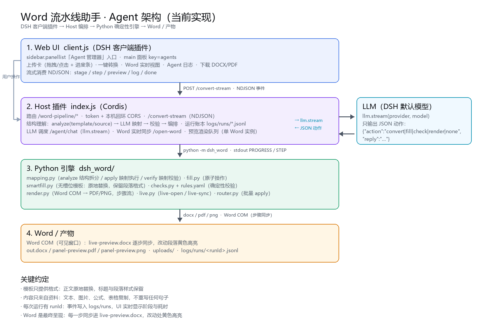
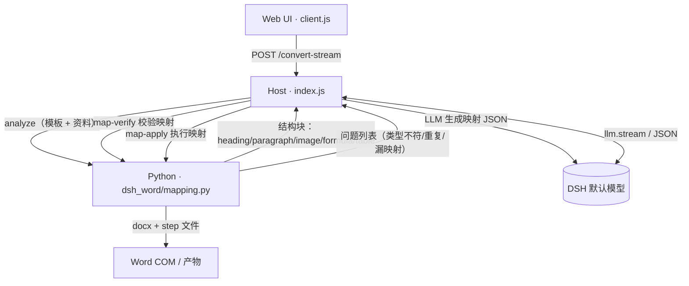

# Word 流水线助手 — 整体架构





## 1. 目标与边界

**目标**：在 DSH 里提供一个"Agent 管理器"式入口，点一次「开始转换」就能把资料内容按模板
格式填进去，过程可见、结果可下载；需要微调时用对话驱动。

**边界**：

- 不重写内容：管线只做"取—放"，文字、图片、公式、表格全部来自资料；
- 不破坏模板：优先复用模板段落/字符格式；
- 不接管 DSH 的会话：本应用是一个独立插件，模型只做"调度"，执行仍由确定性引擎完成。

## 2. 分层

```
┌──────────────────────────────────────────────────────────────┐
│ Web UI（client.js，DSH 客户端插件）                          │
│  · sidebar.panellist 入口  · main 面板（Agent 管理器）        │
│  · 上传卡 / 一键转换 / 流式状态 / 实时预览 / 灯箱 / 日志      │
└───────────────▲───────────────────────────┬──────────────────┘
                │ fetch / NDJSON 流          │ 上传、下载、预览图
┌───────────────┴───────────────────────────▼──────────────────┐
│ Host 插件（index.js，Cordis 插件）                            │
│  · 路由 /word-pipeline/*   · 运行编排 runConvert / executeOp  │
│  · 事件与日志（run ledger） · LLM 调度 handleChat             │
│  · 预览渲染队列（单个 Word 实例，串行）                       │
└───────────────▲───────────────────────────┬──────────────────┘
                │ stdout PROGRESS / STEP     │ 子进程
┌───────────────┴───────────────────────────▼──────────────────┐
│ Python 引擎（dsh_word/）                                      │
│  fill · slots · smartfill · autoplan · router · checks         │
│  omml · ooxml · media · values · render（Word COM）           │
└───────────────▲───────────────────────────┬──────────────────┘
                │ docx / pdf / png           │
┌───────────────┴───────────────────────────▼──────────────────┐
│ 物化产物：uploads/ · fixtures/build/ · logs/runs/             │
└──────────────────────────────────────────────────────────────┘
```

## 3. 关键模块

| 模块 | 职责 |
|---|---|
| `plugin/client.js` | 入口注册、Agent 卡片、上传/转换/对话、流式消费、预览与日志渲染 |
| `plugin/index.js` | HTTP 路由、鉴权（token + 回环 Origin）、编排、LLM 调度、运行日志、预览渲染 |
| `dsh_word/fill.py` | 原子操作执行：表格、文本、图片、公式；步骤文件 |
| `dsh_word/smartfill.py` | 无 `{{ }}` 模板的结构化填充：识别占位段落、追加段落、复制表格 |
| `dsh_word/autoplan.py` | 有槽位模板的自动映射（按文档顺序） |
| `dsh_word/checks.py` + `rules.yaml` | 确定性校验：残留标记、替换字符、公式、粘词、版式、图片宽度 |
| `dsh_word/render.py` | Word COM 渲染：PDF / PNG / 步骤序列（单实例） |
| `dsh_word/router.py` | 批量应用修正（apply） |

## 4. 主流程（一键转换）

```
模板 + 资料
  → analyze：拆成结构块并按 heading 建章节树（sections: heading → 子块），带完整文本
  → LLM 映射：按**章节语义**对齐；图片/公式/表格用 insert-after 锚定到前一块，保持原始顺序
  → 规则校验：类型、重复、漏映射（资料内容缺映射=error）、超长
  → 语义审校（第二次 LLM）：逐条判断"内容放这里是否合理"；不合理则带问题重映射
  → map-apply：原地替换，保留模板标题与段落格式；媒体按顺序插入
      · 每改完一块立即做块级检查（空文本 / 残留 {{ }} / 替换字符 / 图片 / 公式 / 表格）
  → 全部块完成 → 整体检查（checks.py）
  → render：PDF/PNG
```

模型不可用时退回**确定性映射**（模板正文段落按顺序 ← 资料段落，图片/表格/公式追加）。

事件类型：`stage` / `step` / `preview` / `log` / `done` / `error`，NDJSON 一行一条。

## 5. 对话调度（Agent）

```
用户一句话 → /agent/chat → llm.stream(默认模型)
  → 模型只输出 {"action": "...", "reply": "..."}
  → host 执行 runConvert / executeOp / apply
  → 结果与回复返回，预览刷新
```

模型不可用时 `fallback:true`，退回本地指令解析。

## 6. 可观测性（本次新增）

### 6.1 运行账本（run ledger）

- 每次转换、每次对话执行都创建 `runId = <base36 时间>-<随机>`；
- 事件写入 `logs/runs/<runId>.jsonl`，字段：
  `{ t, level, phase, message, op?, slot?, ms?, artifact?, error? }`；
- 内存保留最近 N 条，供 `GET /runs`、`GET /run?id=` 查询；
- 流式响应里同步下发 `{"type":"log", entry}`，UI 实时显示。

### 6.2 事件阶段

`start` / `fill` / `fill.op` / `check` / `render` / `preview` / `chat` / `done` / `error`

### 6.3 UI

- 预览面板顶部显示当前阶段（`等待运行 / 填充 3/6 / 检查 / 渲染 / 完成`）；
- 预览下方「Agent 日志」实时滚动：时间、阶段、消息、耗时；
- 失败时红字定位到具体阶段与操作。

## 7. 失败模式与对策

| 现象 | 原因 | 对策 |
|---|---|---|
| `EBUSY ... .docx` | Word 仍占用上一步文件 | 每次运行独立时间戳目录；渲染串行队列 |
| 上传 403 | 桌面壳拿不到注入 token | 本机回环 + app/file Origin 信任 + CORS |
| 转换 0 步 | 模板无占位符且无法识别结构 | 结构化填充（smartfill）；仍为空则明确报错 |
| 预览过小 | `max-height` 压缩 | 移除限制 + DPI 160 + 点击灯箱 |
| 不知道进行到哪 | 仅终态 | run ledger + 流式 log + 阶段徽标 |

## 8. 扩展点

- **新增 Agent**：在 `client.js` 的 `AGENTS` 注册卡片；Host 增加对应路由前缀与 Python 引擎；
- **新增工具**：`executeOp` 增加分支 + `buildArgs`，并在 `handleChat` 的系统提示里登记 action；
- **新增校验规则**：`rules.yaml` + `checks.py` handler；
- **日志导出**：`logs/runs/*.jsonl` 可直接喂给分析脚本或前端历史页。
